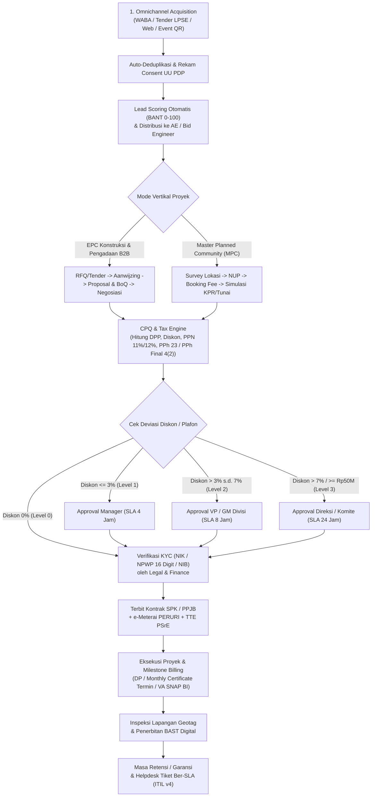
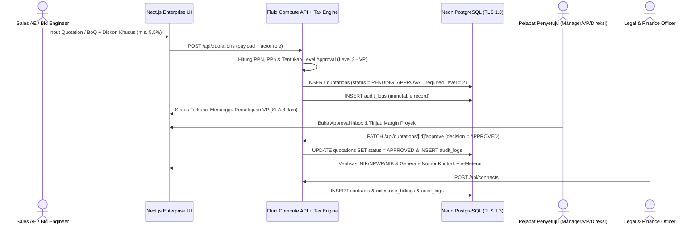
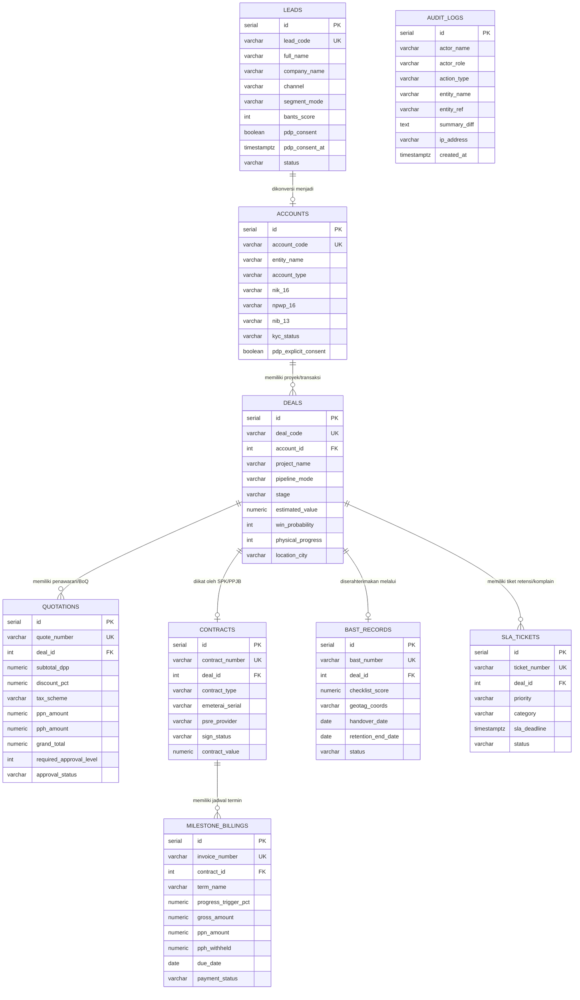

# FUNCTIONAL & TECHNICAL SPECIFICATION DOCUMENT (FSD / TSD) & DESIGN WORKFLOW
**Aplikasi Website Enterprise CRM Proyek MPC & EPC Indonesia**

---

## IDENTITAS PENGENDALIAN DOKUMEN (DOCUMENT CONTROL)

| Atribut Dokumen | Keterangan |
| :--- | :--- |
| **Nama Proyek** | Pengembangan Aplikasi Enterprise CRM Proyek MPC & EPC |
| **Judul Dokumen** | Functional & Technical Specification Document (FSD/TSD) & Design Workflow |
| **Nomor Dokumen** | `MPC/IT-ARC/FSD/CRM-APP/2026/001` |
| **Versi / Revisi** | v1.0 |
| **Tanggal Efektif** | 25 November 2026 |
| **Klasifikasi Keamanan** | **RAHASIA / INTERNAL KORPORASI** *(Dilarang menggandakan tanpa izin tertulis)* |
| **Pemilik Dokumen** | Divisi Arsitektur Sistem & Keamanan Informasi (IT Architecture & InfoSec) |

### RIWAYAT PERUBAHAN DOKUMEN (REVISION HISTORY)

| Versi | Tanggal | Penyusun | Deskripsi Perubahan | Status |
| :--- | :--- | :--- | :--- | :--- |
| v0.1 | 20/11/2026 | Lead System Architect | Penyusunan topologi cloud-native, skema ERD, dan API kontrak | Draf Awal |
| v0.9 | 24/11/2026 | InfoSec & Database Lead | Penambahan skema UU PDP masking, append-only audit log, dan Neon TLS | Tinjauan Teknis |
| v1.0 | 25/11/2026 | Head of IT Architecture | Pengesahan spesifikasi fungsional dan teknis final | Berlaku Efektif |

### LEMBAR PENGESAHAN BERJENJANG (SIGN-OFF MATRIX)

| Peran Otorisasi | Nama Lengkap | Jabatan & Divisi | Tanggal | Tanda Tangan / TTE |
| :--- | :--- | :--- | :--- | :--- |
| **Disusun Oleh (Prepared By)** | `[Nama System Architect]` | Principal System Architect | 25/11/2026 | *(TTE PSrE)* |
| **Diperiksa Oleh (Reviewed By)** | `[Nama CISO / InfoSec]` | Head of Information Security (ISO 27001) | 25/11/2026 | *(TTE PSrE)* |
| **Disetujui Oleh (Approved By)** | `[Nama VP IT]` | VP Teknologi Informasi & Digital | 25/11/2026 | *(TTE & Stempel)* |

---

## BAB I — ALUR PROSES BISNIS END-TO-END (SYSTEM WORKFLOW)

### 1.1 Diagram Alir Siklus Hidup CRM Proyek EPC & MPC

### 1.2 Sequence Diagram Otorisasi Berjenjang & Jejak Audit

---

## BAB II — ARSITEKTUR TEKNIS CLOUD-NATIVE

| Lapisan Arsitektur | Teknologi Standar | Keterangan Implementasi |
| :--- | :--- | :--- |
| **Presentation & Frontend** | Next.js (App Router, TypeScript), React, Tailwind CSS, Lucide Icons | Antarmuka aksesibel WCAG 2.1 AA, responsif untuk Desktop Eksekutif & Tablet Inspeksi Lapangan, Global Command Palette (`Ctrl+K`), dan i18n (`ID`/`EN`). |
| **Application & Compute** | Vercel Fluid Compute (Node.js LTS Runtime) + `@vercel/functions` | API Routes RESTful terukur dengan instrumen observabilitas *Custom Metrics* (`metric()`). |
| **Database & Persistence** | Neon Serverless PostgreSQL (`ap-southeast-1` AWS Singapore) | Koneksi terenkripsi TLS (`sslmode=require`) menggunakan `@neondatabase/serverless`, transaksi ACID, dan integritas referensial penuh. |
| **Security & Governance** | RBAC Context Guard + UU PDP Masking Utility + Append-Only Audit Trail | *Field masking* dinamis berdasarkan hak akses pengguna dan pencatatan mutasi data secara otomatis. |

---

## BAB III — DESAIN BASIS DATA (KAMUS DATA INTI)

---

## BAB IV — SPESIFIKASI ENDPOINT API INTERNAL (RESTful JSON)

| Method | Endpoint | Deskripsi Fungsi | Otorisasi Peran |
| :--- | :--- | :--- | :--- |
| `GET` | `/api/crm/bootstrap` | Mengambil ringkasan KPI, *leads*, *accounts* (dengan masking UU PDP sesuai peran), *deals*, *quotations*, *contracts*, *billings*, *BAST*, *SLA tickets*, dan *audit logs*. | Seluruh Peran Terautentikasi (dengan Filter Masking) |
| `POST` | `/api/crm/leads` | Registrasi prospek baru + deteksi duplikasi + rekam persetujuan UU PDP + hitung skor BANT. | `SALES_AE`, `MANAGER`, `VP_SALES`, `SYSADMIN` |
| `PATCH` | `/api/crm/deals` | Memindahkan tahapan *pipeline* transaksi atau memperbarui progres fisik lapangan (%). | `SALES_AE`, `MANAGER`, `VP_SALES`, `PROJECT_MANAGER` |
| `POST` | `/api/crm/accounts` | Pendaftaran profil klien & dokumen KYC (validasi 16 digit NIK/NPWP & 13 digit NIB) atau verifikasi KYC oleh Legal. | `SALES_AE`, `LEGAL_FINANCE` |
| `POST` | `/api/crm/quotations` | Membuat penawaran CPQ/BoQ dengan perhitungan PPN/PPh otomatis & penentuan level persetujuan (Level 0–3). | `SALES_AE`, `MANAGER`, `VP_SALES` |
| `PATCH` | `/api/crm/quotations` | Menyetujui (*Approve*) atau menolak (*Reject*) pengajuan deviasi diskon sesuai wewenang jabatan. | `MANAGER` (L1), `VP_SALES` (L2), `DIREKSI` (L3) |
| `POST` | `/api/crm/contracts` | Menerbitkan kontrak digital SPK/PPJB + nomor seri e-Meterai PERURI + jadwal termin awal. | `LEGAL_FINANCE`, `VP_SALES`, `DIREKSI` |
| `PATCH` | `/api/crm/billings` | Rekonsiliasi status pembayaran termin Virtual Account SNAP BI (`PAID` / `ISSUED`). | `LEGAL_FINANCE` |
| `POST` | `/api/crm/bast` | Menerbitkan Berita Acara Serah Terima (BAST) digital beserta *geotag* & masa retensi otomatis. | `PROJECT_MANAGER`, `DIREKSI` |
| `POST` / `PATCH` | `/api/crm/tickets` | Membuka tiket keluhan masa retensi ber-SLA ITIL v4 atau menyelesaikan tiket. | `HELPDESK`, `PROJECT_MANAGER` |
